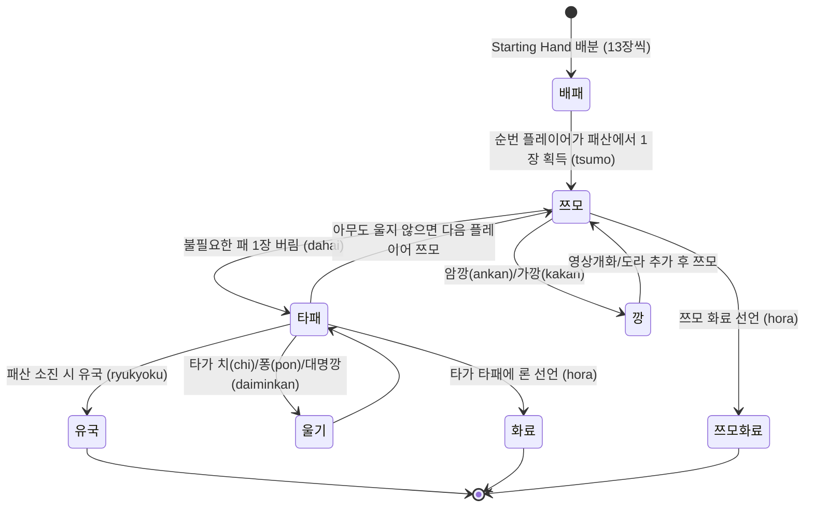

# 리치 마작(Riichi Mahjong) 도메인 가이드 (Domain Knowledge)

이 문서는 **Mahjong Sensei** 프로젝트를 개발하고 분석 로직을 구현하는 데 필요한 **리치 마작의 기본 규칙, 패 표기법, 샹텐수 알고리즘 원리, 작혼(Mahjong Soul) 시스템 특성**을 상세히 정리한 도메인 매뉴얼입니다.

---

## 1. 마작 패 체계 및 문자열 표기법 (Tile Notation)

마작은 총 136장의 패(3인마의 경우 일부 제외)를 사용하며, 본 프로젝트에서는 표준 문자열 표기법을 준수합니다.

### 1.1 수패 (Suited Tiles)
- **만수패 (Manzu, 萬子)**: `1m` ~ `9m` (총 9종류 각 4장)
- **통수패 (Pinzu, 筒子)**: `1p` ~ `9p` (총 9종류 각 4장)
- **삭수패 (Souzu, 索子)**: `1s` ~ `9s` (총 9종류 각 4장)

### 1.2 자패 (Honor Tiles, 字牌)
- **풍패 (Wind Tiles, 風牌)**:
  - `1z`: 동(東, East)
  - `2z`: 남(南, South)
  - `3z`: 서(西, West)
  - `4z`: 북(北, North)
- **삼원패 (Dragon Tiles, 三元牌)**:
  - `5z`: 백(白, White)
  - `6z`: 발(發, Green)
  - `7z`: 중(中, Red)

### 1.3 적도라 (Red Fives, 赤ドラ)
- 작혼 등 현대 리치 마작에서는 5번 수패 중 1장씩(규칙에 따라 2장)이 붉은색으로 칠해져 상시 1판의 가치를 지닙니다.
- 표기법:
  - 적 5만: `0m` (정규화 시 `5m`으로 처리하되 도라 판정 플래그 유지)
  - 적 5통: `0p` (정규화 시 `5p`)
  - 적 5삭: `0s` (정규화 시 `5s`)

---

## 2. 샹텐수 (Shanten, 向聴数) 계산 원리

**샹텐수**란 현재 손패가 **화료(텐파이 및 완성) 상태가 되기 위해 필요한 최소 유효패 교환 횟수**를 의미합니다.

- **-1 샹텐**: 화료 완성 상태 (Hora / Agari)
- **0 샹텐 (텐파이, Tenpai)**: 1장만 더 들어오면 화료가 가능한 상태
- **1 샹텐**: 텐파이가 되기 위해 1장의 유효패가 더 필요한 상태
- **2 ~ 6 샹텐**: 배패(시작 손패)의 일반적인 상태 (평균 배패 샹텐수는 약 **3.5 샹텐**)

### 손패 완성 형태의 3가지 유형
1. **일반형 (Standard Form - 4멘츠 1또이츠)**:
   - 4개의 멘츠(순츠 `123m` 또는 커츠 `555p`) + 1개의 또이츠(머리 `77s`)
   - 공식: `8 - (2 * 완성멘츠수 + 멘츠후보수 + 또이츠유무)`
2. **치또이츠 (Seven Pairs, 七対子)**:
   - 서로 다른 종류의 패 7쌍(7또이츠)으로 구성
   - 공식: `6 - 또이츠수 + (동일패 3~4장 낭비 보정)`
3. **국사무쌍 (Thirteen Orphans, 国士無双)**:
   - 13종류의 요구패(1m, 9m, 1p, 9p, 1s, 9s, 1z~7z) + 이 중 1종류의 머리
   - 공식: `13 - 고유요구패수 - 머리존재여부(0 or 1)`

> 💡 **알고리즘 구현 주의**: `MetricCalculator`는 항상 3가지 형태 중 **가장 작은 샹텐수 값**을 최종 샹텐수로 채택합니다.

---

## 3. 작혼(Mahjong Soul) 대국 환경: 4인마 vs 3인마

Mahjong Sensei는 4인마(4P)와 3인마(3P)를 모두 지원해야 하므로 두 룰셋의 도메인적 차이를 명확히 인지해야 합니다.

| 구분 | 4인마 (4P - 사총) | 3인마 (3P - 삼총) | 도메인 로직 영향 |
| :--- | :--- | :--- | :--- |
| **참여 인원** | 4명 (동, 남, 서, 북) | 3명 (동, 남, 서 / 북가 없음) | `SeatIndex` (0, 1, 2) vs (0, 1, 2, 3) |
| **제외 패** | 모든 수패 사용 | 만수패 2m ~ 8m 제외 (1m, 9m만 사용) | 샹텐수 계산 시 유효패 풀 축소 |
| **기타 특수 룰** | 치(Chi) 가능 | **치(Chi) 불가능**, 퐁/깡만 허용 | 패효율 알고리즘에서 치 분기 제외 |
| **북패 (4z)** | 일반 객풍/자풍패 | **키타(Kita, 拔北)** 빼기 도라로 사용 가능 | 타패/화료 판정 시 특수 액션 분기 |
| **순위 및 점수** | 1위, 2위, 3위, **4위(라스)** | 1위, 2위, **3위(라스)** | **3인마에서는 절대 4위가 나올 수 없음** |

---

## 4. 패보(Paipu) 데이터 구조 및 액션 라이프사이클

작혼 패보는 각 국(Round)마다 다음과 같은 순서로 진행됩니다.

### 필수 확인 도메인 불변식 (Invariants)
1. **타패 유효성**: 순번에 맞지 않거나 손패에 없는 패를 버릴 수 없습니다.
2. **후리텐 (Furiten)**: 자신이 한 번 버린 패로는 론 화료를 할 수 없습니다 (단, 쯔모 화료는 가능).
3. **리치 선언 조건**: 멘젠(울지 않은 상태) 텐파이 상태에서 1000점의 공탁금을 지불해야 합니다.
